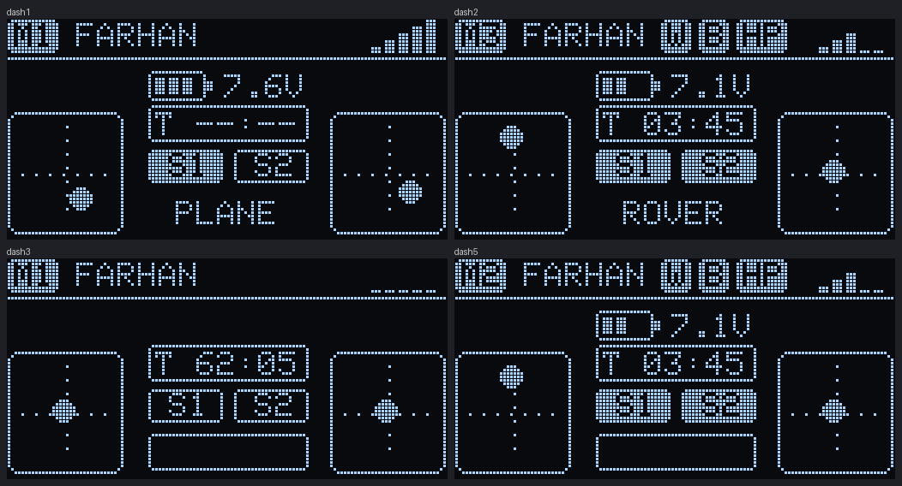
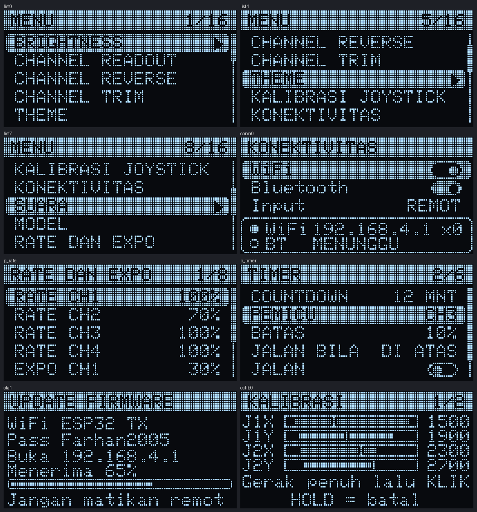
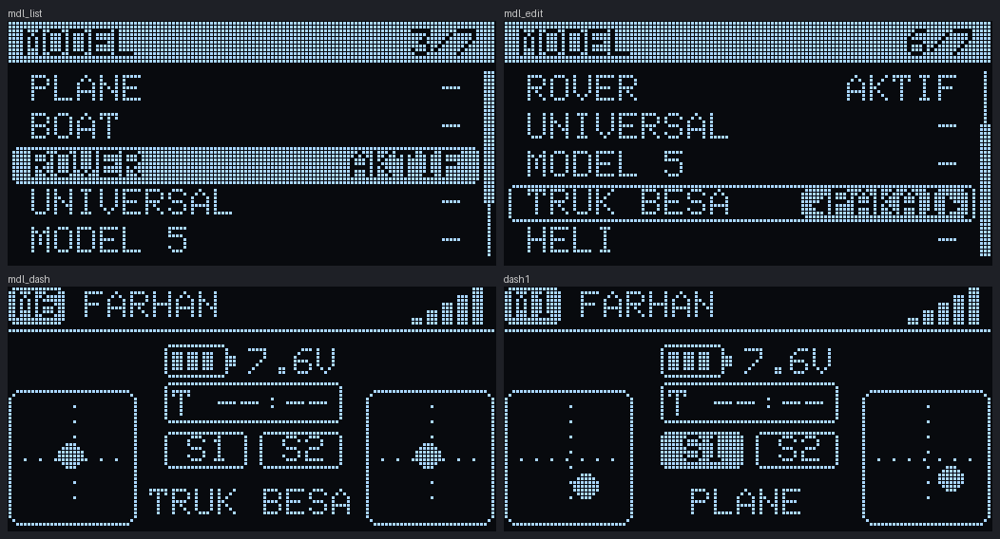
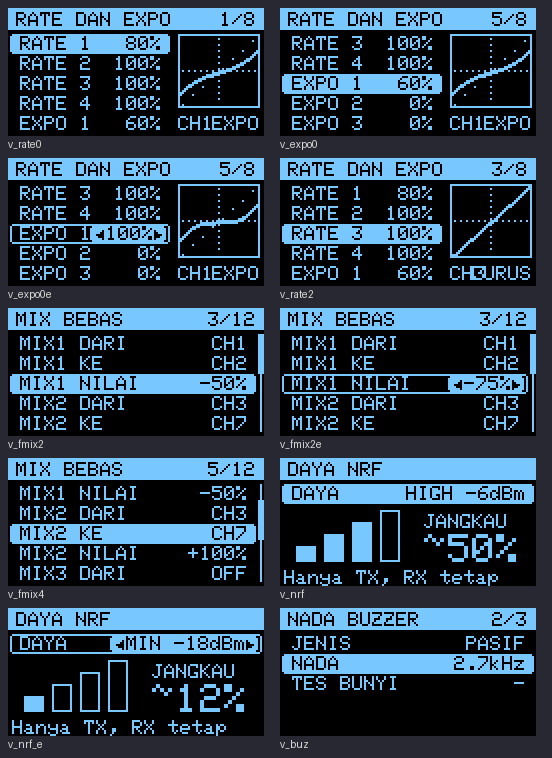
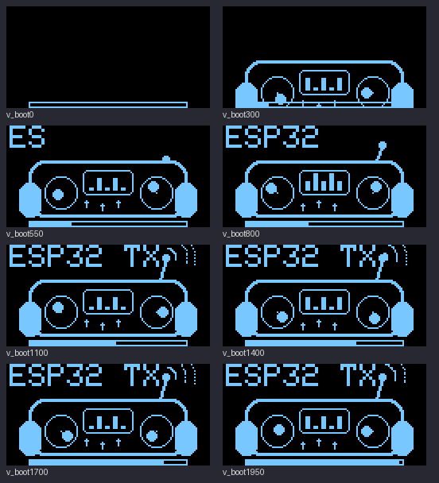

# ESP32 TX

Remot RC buatan sendiri (DIY) berbasis ESP32 dengan radio NRF24L01, layar OLED SSD1306, dan encoder EC11. Aplikasi Android mengendalikan dan memantau remot lewat Bluetooth Low Energy (BLE), termasuk update firmware tanpa kabel.

## Tampilan

Layar OLED remot (dirender dari firmware v3.0):

Daftar model di remot (nama dari aplikasi) dan nama model di dashboard:

Firmware 3.3: grafik rate dan expo, mix bebas, daya NRF, nada buzzer (OLED) dan animasi booting:

Ikon aplikasi:

## Skematik

File vektor: [`docs/skematik/skematik-wiring.svg`](docs/skematik/skematik-wiring.svg). Dibuat dari definisi pin di firmware; catu daya tidak ada di kode, jadi tidak digambar.

## Unduh

- Aplikasi Android: [`apk/ESP32-TX.apk`](apk/ESP32-TX.apk) atau [Releases](https://github.com/PTRFarhan/esp32-tx-app/releases/tag/latest)
- Firmware PlatformIO: folder [`firmware/`](firmware/)

## Isi repository

| Folder | Isi |
|---|---|
| `firmware/` | Firmware ESP32 (proyek PlatformIO). Lihat `firmware/CARA_PAKAI.txt` |
| `android/` | Aplikasi Android (Java). Lihat `android/PANDUAN_APLIKASI.txt` |
| `docs/` | Protokol Bluetooth dan paket NRF24, pinout, tampilan OLED |
| `docs/skematik/` | Skematik wiring (SVG dan PNG) |
| `apk/` | File aplikasi `ESP32-TX.apk` |
| `UPLOAD_SEMUA.bat` | Klik dua kali: kirim ke GitHub, bangun APK, unduh APK |

## Fitur

- 8 channel (CH1 sampai CH8), model bisa ditambah dari aplikasi (sampai 10, nama sendiri, ikut tampil di remot) dengan reverse, trim, rate, expo (dengan grafik kurva), endpoint, mixing (ELEVON, V-TAIL), mix bebas 4 jalur untuk semua channel, failsafe, dan timer. Daya pancar NRF dan jenis serta nada buzzer bisa diatur dari menu remot dan aplikasi
- Kendali dari HP lewat Bluetooth dengan failsafe otomatis, dan stik remot kembali aktif kalau Bluetooth putus
- Pantauan langsung dan semua pengaturan dari aplikasi, cadangan dan pemulihan pengaturan
- Update firmware lewat Bluetooth dari aplikasi, atau lewat WiFi dari browser (menu UPDATE FIRMWARE)
- WiFi dan Bluetooth tidak bisa menyala bersamaan, karena berbagi satu radio

## Mulai cepat

1. Firmware: buka folder `firmware/` di PlatformIO (VS Code), Build, lalu Upload lewat USB. Pemasangan pertama wajib lewat USB.
2. Aplikasi: klik dua kali `UPLOAD_SEMUA.bat`. APK terbaru juga ada di halaman Releases.
3. Di remot: menu KONEKTIVITAS, Bluetooth ON. Buka aplikasi lalu Hubungkan ("ESP32 TX").

## Dokumentasi

- `docs/PROTOKOL.md`: protokol Bluetooth, perintah aplikasi, paket NRF24, update firmware
- `docs/PINOUT_DAN_SKEMATIK.md`: pin dan diagram pengkabelan
