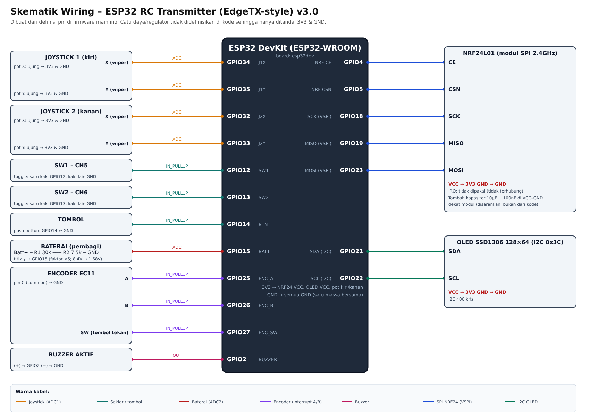
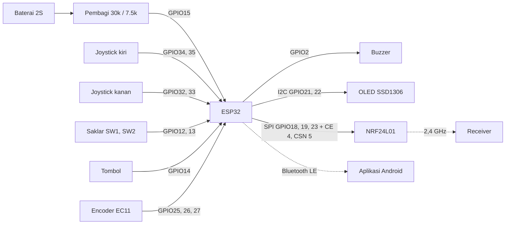

# Pinout dan skema pengkabelan

Catatan: tabel dan diagram di bawah dibuat dari definisi pin di kode firmware (`firmware/src/main.ino`), bukan dari gambar skematik asli. Kalau kamu punya file skematik (KiCad, Fritzing, EasyEDA, PDF, foto), taruh di folder `docs/skematik/` supaya ikut tersimpan di GitHub.

## ESP32 (modul 30 pin, board `esp32dev`)

| Fungsi | Komponen | Pin ESP32 | Catatan |
|---|---|---|---|
| Stik 1 sumbu X | Potensiometer joystick kiri | GPIO34 | ADC1, hanya input |
| Stik 1 sumbu Y | Potensiometer joystick kiri | GPIO35 | ADC1, hanya input |
| Stik 2 sumbu X | Potensiometer joystick kanan | GPIO32 | ADC1 |
| Stik 2 sumbu Y | Potensiometer joystick kanan | GPIO33 | ADC1 |
| Saklar SW1 | Saklar toggle (CH5) | GPIO12 | Pin strapping, jangan ditarik HIGH saat boot |
| Saklar SW2 | Saklar toggle (CH6) | GPIO13 | |
| Sensor baterai | Pembagi tegangan | GPIO15 | ADC2, tidak terbaca saat WiFi aktif (nilai ditahan) |
| Tombol | Push button | GPIO14 | |
| Encoder A | EC11 | GPIO25 | |
| Encoder B | EC11 | GPIO26 | |
| Encoder klik | EC11 (tombol) | GPIO27 | |
| Buzzer | Buzzer aktif | GPIO2 | |
| NRF24L01 CE | Modul NRF24L01 | GPIO4 | |
| NRF24L01 CSN | Modul NRF24L01 | GPIO5 | |
| NRF24L01 SCK | Modul NRF24L01 | GPIO18 | SPI bawaan (VSPI) |
| NRF24L01 MISO | Modul NRF24L01 | GPIO19 | SPI bawaan (VSPI) |
| NRF24L01 MOSI | Modul NRF24L01 | GPIO23 | SPI bawaan (VSPI) |
| OLED SDA | SSD1306 128x64 | GPIO21 | I2C bawaan, alamat 0x3C, 400 kHz |
| OLED SCL | SSD1306 128x64 | GPIO22 | I2C bawaan |

Pin SPI dan I2C memakai pin bawaan Arduino ESP32 karena kode tidak mengatur pin khusus. Sensor baterai memakai pembagi tegangan R1 = 30 kOhm (ke baterai) dan R2 = 7,5 kOhm (ke GND), titik tengahnya ke GPIO15. Faktor pembagi 5, jadi baterai 2S (8,4 V penuh) menjadi sekitar 1,7 V di pin. Saran: pindahkan ke GPIO36 atau GPIO39 (ADC1) supaya tetap terbaca saat WiFi menyala, lalu ubah `#define SW3`.

Catatan NRF24L01: beri kapasitor 10 uF sampai 100 uF di pin VCC dan GND modul, dan pakai 3,3 V (bukan 5 V).

## Diagram blok

